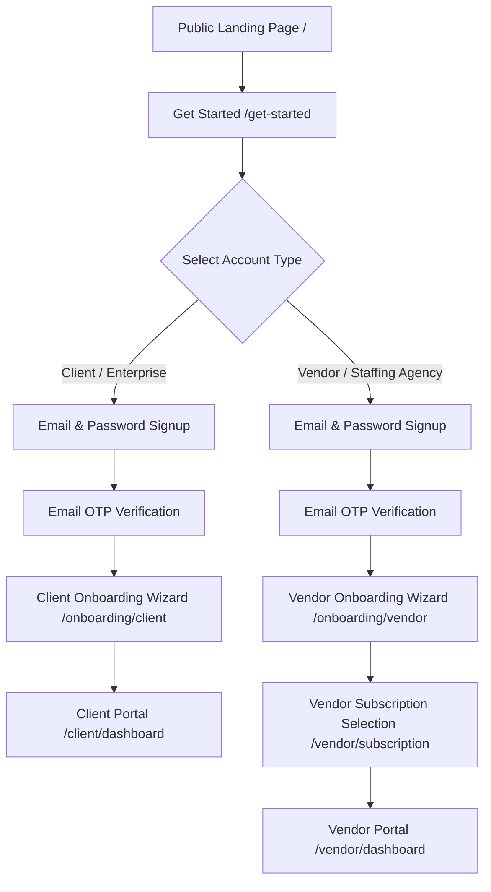

# StaffSync Platform — Complete Page Directory & User Flow Guide

> **Audience:** Non-Technical Stakeholders, Project Managers, Operations Teams, Sales & Business Executives.  
> **Purpose:** A complete, plain-English reference of every screen and page across the StaffSync platform—from initial sign-up and onboarding to the Client and Vendor portals.

---

## 📌 Executive Summary

**StaffSync** is a dedicated B2B technology staffing marketplace. It bridges two distinct user groups:
1. **Clients (Enterprises & Hiring Companies):** Organizations looking to hire pre-vetted senior software engineers and IT consultants on flexible Contract-to-Contract (C-C) or Contract-to-Hire (C-H) terms within 48 hours.
2. **Vendors (Staffing Agencies & Software Consultancies):** Verified IT suppliers who have available "bench" tech talent and want to deploy them directly into enterprise client openings with transparent pricing and fast payouts.

Below is the complete walkthrough of every page, grouped by journey phase.

---

## 🗺️ High-Level User Journey

---

## Part 1: Public & Authentication Pages

These are the public-facing pages that anyone on the web can access before logging in.

| Page Name | Web Address (URL) | Who Uses It | What It Does (In Simple Terms) |
| :--- | :--- | :--- | :--- |
| **Landing / Home Page** | `/` | All visitors, prospective clients & vendors | The main front door of the company. Explains the 48-hour hiring model, platform benefits, client testimonials, security certifications, and call-to-action buttons. |
| **About Us** | `/about` | General public, investors, partners | Explains company mission, leadership vision, and why StaffSync was founded to replace legacy middleman staffing. |
| **Pricing** | `/pricing` | Prospective clients and vendors | Details transparent pricing tiers, membership models, and platform fee structure. |
| **Standard Login** | `/login` | Registered users (Clients & Vendors) | Secure sign-in screen where existing users enter email and password (or continue with Google/OAuth) to enter their dashboard. |
| **Modern Split Login** | `/login-2` | Registered users | An alternative, modern split-screen login page designed for quick account access and role-switching. |
| **Get Started (Role Selection & Registration)** | `/get-started` | New users signing up | The primary entry funnel. Users select whether they are hiring talent (**Client**) or supplying talent (**Vendor**), enter their email & password, and complete a 6-digit OTP code sent to their inbox. |

---

## Part 2: Onboarding Flow (Role-Based Setup)

Once email verification is complete, users are directed to the onboarding wizard to establish their organization profile and trust credentials.

### 🏢 Client Onboarding (`/onboarding/client`)
*Designed for enterprises looking to post jobs and hire.*

* **Step 1: Company & Contact Information**
  * **What it asks for:** Official Company Name, GST Number (auto-verified for legal legitimacy), Corporate Identification Number (CIN), Corporate Website URL, and Primary Contact Person details (Name, Work Email, and Phone number verified via instant mobile OTP).
  * **Why it matters:** Ensures only legitimate, tax-registered corporate entities can post jobs and access talent.
* **Step 2: Company Profile & Socials**
  * **What it asks for:** Industry selection (e.g., Software Development, FinTech, Healthcare), Company Headcount / Size (1–10, 11–50, 50–200, 200+), Founded Year, Headquarters City/Country, and Official LinkedIn profile.
  * **Why it matters:** Generates an enterprise profile that vendors and candidates see when deciding to work with the client.
* **Step 3: Verification & Success Confirmation**
  * Displays a celebratory success screen with security badges (ISO 27001, C-C Compliant) and a direct button: **"Go to Client Dashboard"**.

---

### 🤝 Vendor Onboarding (`/onboarding/vendor`)
*Designed for staffing firms and consultancies supplying bench consultants.*

* **Step 1: Agency & Point of Contact Details**
  * **What it asks for:** Staffing Agency Name, Registered Business Identification / GST Number, Corporate Email, Official Website, and Primary Account Manager Contact (Name, Phone number verified via instant mobile OTP).
  * **Why it matters:** Prevents fake agencies and verifies that the supplier has valid business credentials.
* **Step 2: Vendor Model, Specialization & Compliance**
  * **What it asks for:** Primary Engagement Models offered (C-C, C-H, Full-Time), Core Tech Specialties (React, Python, Cloud/AWS, AI/ML, DevOps, Java, etc.), Team Size, and Compliance Certifications (ISO, SOC2, CMMI).
  * **Why it matters:** Allows the platform's AI matching engine to automatically send relevant job openings directly to this agency.
* **Step 3: Subscription Selection (`/vendor/subscription`)**
  * Vendors select their membership plan (e.g., Starter, Growth, or Enterprise) to activate their bench listings and unlock direct job submissions.

---

## Part 3: Client Portal (Hiring Side)

*All pages located under `/client/*`. Designed specifically for hiring managers, HR teams, and department heads.*

| # | Page Name | URL | Core Purpose & Features for Non-Tech Users |
| :-: | :--- | :--- | :--- |
| **1** | **Client Dashboard** | `/client/dashboard` | **The Command Center.** Gives a live executive summary: total active requirements, candidates undergoing interview, top matched talent profiles, hiring velocity metrics, and recent activity logs. |
| **2** | **My Requirements** | `/client/requirements` | **Job Postings Hub.** View all open, active, paused, or closed hiring requisitions. Hiring managers can click **"Create Requirement"** to publish a new job description (role title, skills, experience, budget, remote/hybrid). Includes downloading the JD as a formatted PDF. |
| **3** | **Candidate Submissions** | `/client/submissions` | **Candidate Pipeline & Hiring Decision Board.** Where clients view profiles submitted by approved vendors for each job. Features AI match percentage (e.g., 94% match), automated candidate strengths & weaknesses breakdown, resume view, and one-click actions: **Shortlist**, **Schedule Interview**, **Make Offer**, or **Decline**. |
| **4** | **Vendor Performance** | `/client/vendor-performance` | **Supplier Rating & Quality Scorecard.** Compares all vendor partners based on objective data: submission-to-hire ratio, average response turnaround time, candidate quality ratings, and retention scores. Helps clients identify which staffing agencies deliver the best talent. |
| **5** | **Billing & Invoices** | `/client/billing` | **Financial & Accounting Hub.** View monthly platform invoices, payment receipts, outstanding balances, upcoming billing dates, and invoice download links (PDF). Keeps finance and accounts payable teams happy. |
| **6** | **Notifications** | `/client/notifications` | **Alerts & Updates Inbox.** Chronological feed of critical events: "New candidate submitted for React Engineer", "Interview scheduled for Sara Khan", "Requirement status updated", etc. |
| **7** | **Profile & Organization** | `/client/profile` | **Company & Team Management.** Edit company overview, headquarters address, legal entity numbers, password & 2FA security, and manage team members ("Sub-users") who can post jobs and review candidates. |
| **8** | **Help & Support** | `/client/support` | **Customer Assistance.** Quick access to email helpdesk, hiring advisory assistance, technical issue reporting, and knowledge base articles. |

---

## Part 4: Vendor Portal (Talent Supplier Side)

*All pages located under `/vendor/*`. Designed for staffing agency owners, bench sales managers, and recruiters.*

| # | Page Name | URL | Core Purpose & Features for Non-Tech Users |
| :-: | :--- | :--- | :--- |
| **1** | **Vendor Dashboard** | `/vendor/dashboard` | **Agency Business Overview.** Displays total bench consultants currently listed, live client opportunities available, number of candidates in interview stages, total revenue/placement earnings, and real-time activity feed. |
| **2** | **My Bench** | `/vendor/bench` | **Bench Talent Inventory.** The digital catalog of consultants available for deployment. Vendors can add candidate profiles (Name, Primary Skills, Total Experience, Hourly Rate, Notice Period / Availability, and Resume/Certificates). |
| **3** | **Opportunities** | `/vendor/opportunities` | **Live Client Job Marketplace.** A live board of client requirements that need contractors. Vendors can filter jobs by tech stack, budget rate, or location, and immediately submit a matching consultant from their bench with one click. |
| **4** | **Submission Tracking** | `/vendor/submissions` | **Recruitment Pipeline Tracker.** Tracks the step-by-step progress of every candidate submitted across all client jobs: *Submitted ➔ Under Review ➔ Shortlisted ➔ Interview Scheduled ➔ Offer Extended ➔ Joined / Rejected*. Prevents candidate status from falling through the cracks. |
| **5** | **Client Performance** | `/vendor/client-performance` | **Client Relationship Analytics.** Informs vendors which clients review profiles fastest, which clients have the highest interview rates, and client payment turnaround times so agencies know who to prioritize. |
| **6** | **Billing & Payouts** | `/vendor/billing` | **Earnings & Payout Tracker.** Real-time ledger of earned placement fees, cleared contractor payouts, pending transactions, and withdrawal requests directly to the vendor's bank account. |
| **7** | **Subscription & Plans** | `/vendor/subscription` | **Agency Membership Management.** Manage the vendor tier (Starter, Growth, Pro), view remaining profile submission allowances, upgrade billing cycles, and renew agency benefits. |
| **8** | **Notifications** | `/vendor/notifications` | **Business Alerts.** Instant alerts when a client posts a job that matches the vendor's bench, when a client shortlists a candidate, or when an interview time is confirmed. |
| **9** | **Agency Profile** | `/vendor/profile` | **Vendor Brand & Credential Page.** Company overview, GST/tax information, list of primary technical capabilities, contact points, and sub-user logins for internal agency recruiters. |
| **10** | **Help & Support** | `/vendor/support` | **Vendor Support Desk.** Dedicated channels to resolve contract questions, billing/payout queries, candidate dispute resolution, or technical bug reports. |

---

## 📊 Quick Summary Table (All Pages At-A-Glance)

| Category | Page Title | Route Path | Primary User |
| :--- | :--- | :--- | :--- |
| **Public / Marketing** | Home / Landing Page | `/` | Anyone / Public |
| **Public / Marketing** | About Us | `/about` | Anyone / Public |
| **Public / Marketing** | Pricing | `/pricing` | Anyone / Public |
| **Auth** | Sign In / Login | `/login` | Registered Users |
| **Auth** | Split Screen Sign In | `/login-2` | Registered Users |
| **Registration** | Get Started & Email OTP | `/get-started` | New Signups |
| **Onboarding** | Client Setup Wizard | `/onboarding/client` | New Clients |
| **Onboarding** | Vendor Setup Wizard | `/onboarding/vendor` | New Vendors |
| **Onboarding** | Vendor Plan Selection | `/vendor/subscription` | New Vendors |
| **Client Portal** | Dashboard Overview | `/client/dashboard` | Enterprise Hiring Teams |
| **Client Portal** | My Job Requirements | `/client/requirements` | Enterprise Hiring Teams |
| **Client Portal** | Candidate Submissions | `/client/submissions` | Enterprise Hiring Teams |
| **Client Portal** | Vendor Performance | `/client/vendor-performance` | Enterprise Hiring Teams |
| **Client Portal** | Billing & Invoices | `/client/billing` | Finance / Admin Teams |
| **Client Portal** | Notifications | `/client/notifications` | Enterprise Hiring Teams |
| **Client Portal** | Profile & Team Members | `/client/profile` | Enterprise Hiring Teams |
| **Client Portal** | Help & Support | `/client/support` | Enterprise Hiring Teams |
| **Vendor Portal** | Dashboard Overview | `/vendor/dashboard` | Agency Owners / Recruiters |
| **Vendor Portal** | My Bench (Talent Pool) | `/vendor/bench` | Agency Owners / Recruiters |
| **Vendor Portal** | Job Opportunities | `/vendor/opportunities` | Agency Owners / Recruiters |
| **Vendor Portal** | Submission Tracking | `/vendor/submissions` | Agency Owners / Recruiters |
| **Vendor Portal** | Client Performance | `/vendor/client-performance` | Agency Owners / Recruiters |
| **Vendor Portal** | Billing & Payouts | `/vendor/billing` | Agency Accounts / Owners |
| **Vendor Portal** | Subscription & Plan | `/vendor/subscription` | Agency Owners |
| **Vendor Portal** | Notifications | `/vendor/notifications` | Agency Owners / Recruiters |
| **Vendor Portal** | Agency Profile | `/vendor/profile` | Agency Owners |
| **Vendor Portal** | Help & Support | `/vendor/support` | Agency Owners / Recruiters |

---

## 💡 Notes for Sharing & Presentation
* This document is saved in the repository at [`docs/product/PLATFORM_PAGES_GUIDE.md`](file:///c:/Users/Dell/OneDrive%20-%20ITVET%20TECHNOLOGIES%20PRIVATE%20LIMITED/theme-color/docs/product/PLATFORM_PAGES_GUIDE.md).
* It can be opened with any Markdown reader, Notion, Google Docs, Microsoft Word, or exported directly to PDF for clients, executives, and non-technical team members.
